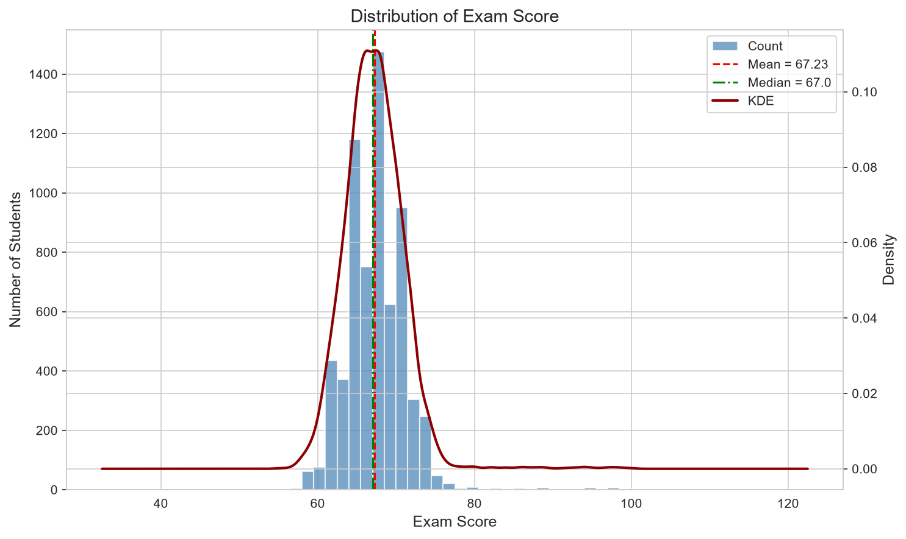
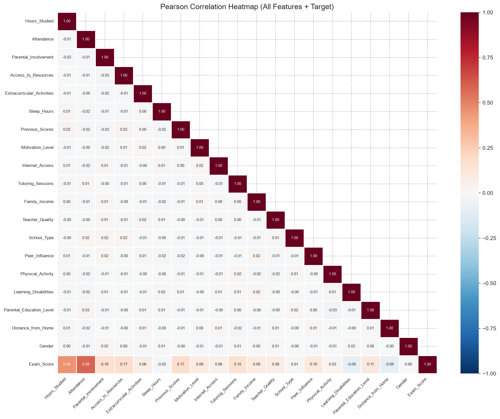
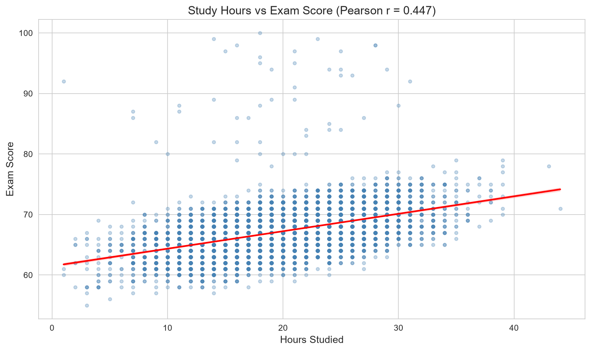
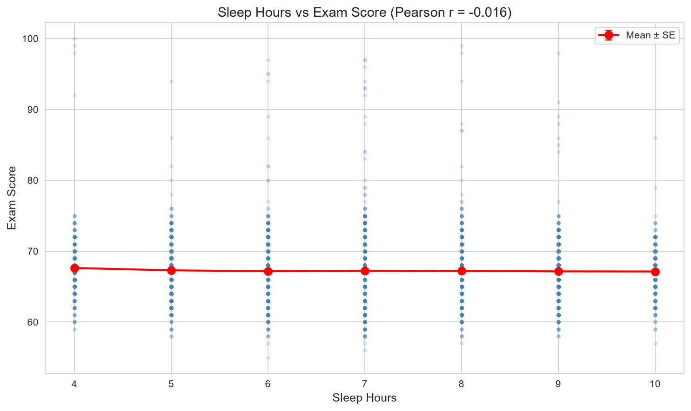
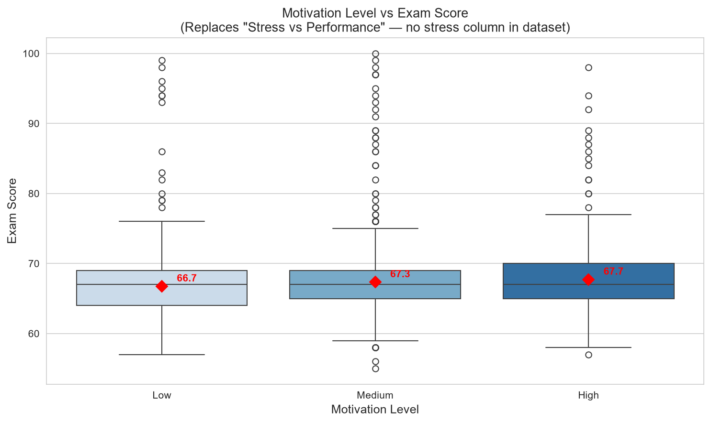
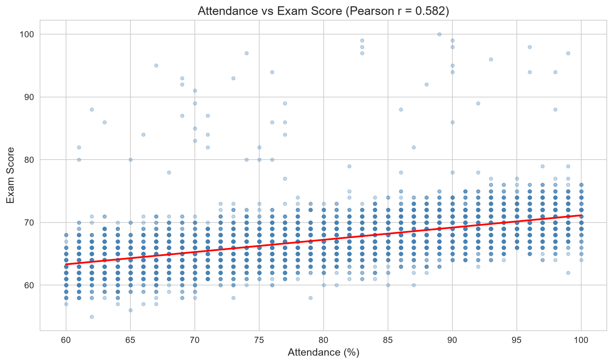
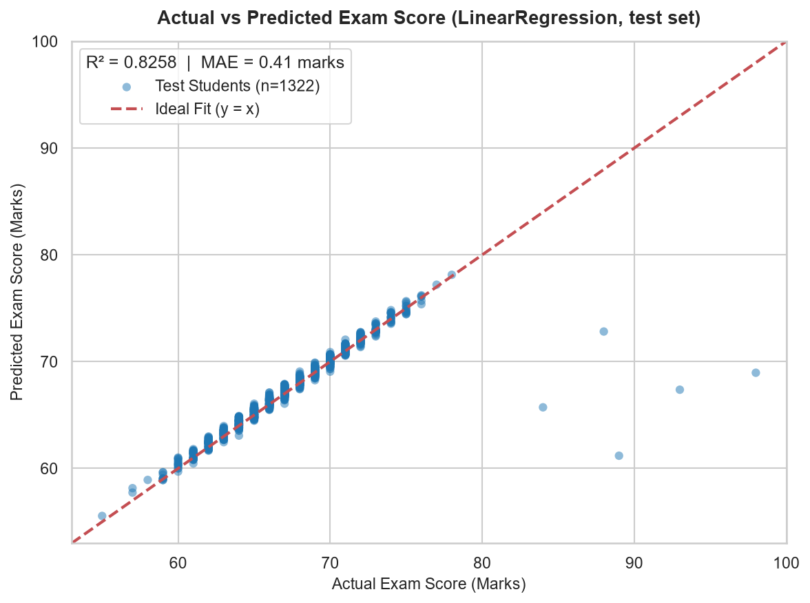
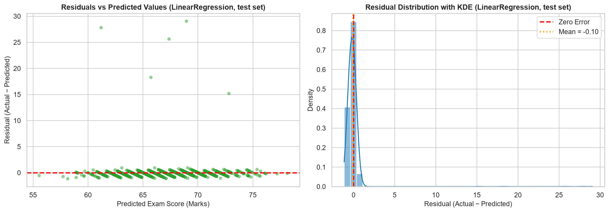
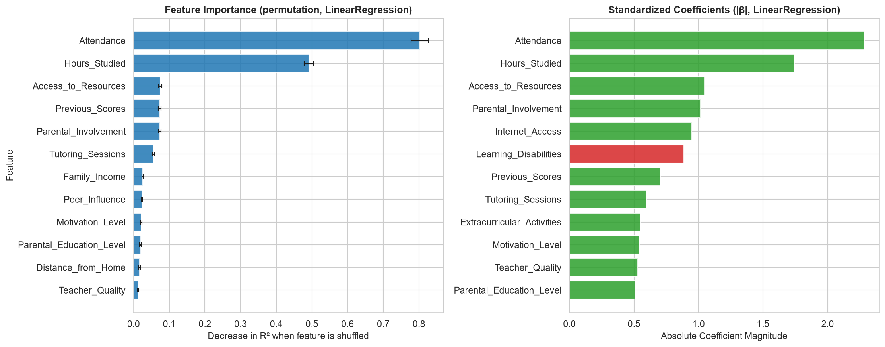

# Empirical Investigation of Academic, Behavioral, and Environmental Correlates of Student Exam Performance

**Course:** ECSCI24302 – Machine Learning Essentials (Project-Based Learning)  
**Academic Term:** Semester 5, B.Tech Computer Science & Engineering  
**Institution:** [Department of Computer Science & Engineering, University Name — TO BE FILLED]  
**Date:** October 25, 2026  

**Project Team Members:**
- `[Student Name 1 — Enrolment Number — TO BE FILLED]`
- `[Student Name 2 — Enrolment Number — TO BE FILLED]`
- `[Student Name 3 — Enrolment Number — TO BE FILLED]`
- `[Student Name 4 — Enrolment Number — TO BE FILLED]`

**Faculty Supervisor / Mentor:**
- `[Faculty Guide Name, Designation, Department — TO BE FILLED]`

---

## 2. Abstract

Accurately identifying the determinants of student examination performance is a foundational challenge in educational data mining. This project presents a leak-free, reproducible machine learning pipeline evaluating how academic habits, extra institutional support, personal routines, and socioeconomic backgrounds relate to student exam scores. Utilizing the *Student Performance Factors* dataset ($N = 6,606$ validated student records after domain screening), we benchmarked four regression models: a Dummy mean baseline, Ordinary Least Squares Linear Regression, Random Forest Regressor, and Gradient Boosting Regressor. Models were developed under a leak-free 5-fold cross-validation framework and evaluated on an independent 20% held-out test set ($n = 1,322$). 

Linear Regression emerged as the optimal architecture, achieving a test $R^2$ of **0.8258**, a Mean Absolute Error (MAE) of **0.4103 marks**, and a Root Mean Squared Error (RMSE) of **1.5178 marks**, comfortably surpassing the project benchmark target of $R^2 \ge 0.75$. Model interpretation via permutation importance and standardized coefficients demonstrated that **Attendance** ($\beta = +2.285$, Permutation $\Delta R^2 = 0.8019$) and **Hours_Studied** ($\beta = +1.743$, $\Delta R^2 = 0.4916$) are the two dominant positive predictors, whereas sleep duration and gender exhibited virtually zero predictive value. Residual analysis revealed that prediction error is remarkably low across 98.7% of students (MAE ~0.3 marks), with residual variance overwhelmingly concentrated in an unexplained high-score tail (ten extreme outliers accounted for 93.39% of total test squared error). Crucially, we emphasize that these empirical findings demonstrate statistical associations rather than proven causal mechanisms.

---

## 3. Introduction

Educational achievement serves as a vital indicator of student development and institutional efficacy. However, students, educators, and counselors often lack empirical clarity regarding which daily behaviors and environmental factors associate most strongly with academic outcomes. While intuitive beliefs frequently prioritize sleep duration or extracurricular involvement, educational institutions require quantitative, data-driven evidence to allocate academic counseling and support resources effectively.

Machine learning offers rigorous mathematical tools to model tabular educational records, quantify feature importance, and generate individual predictions. Nevertheless, educational data mining frequently suffers from methodological flaws, including data leakage across train and test sets, unjustified outlier trimming, and conflation of statistical correlation with causal intervention. 

This project was conceived as an end-to-end, reproducible investigation designed to enforce strict machine learning hygiene. By building a unified Python pipeline with zero data leakage, validating multiple regression architectures, and conducting granular error analysis, we provide transparent empirical insights into student performance patterns.

---

## 4. Problem Statement & Motivation

### 4.1 Problem Formulation
Given a feature vector $\mathbf{x}_i \in \mathbb{R}^d$ capturing a student's study habits, school attendance, demographic context, and support systems, the objective is to learn a mapping function $f: \mathbb{R}^d \to \mathbb{R}$ that predicts the continuous examination score $y_i \in [0, 100]$ such that generalization error on unseen students is minimized:

$$\min_{f} \frac{1}{n} \sum_{i=1}^{n} \mathcal{L}(y_i, f(\mathbf{x}_i))$$

where $\mathcal{L}$ denotes the mean squared error and mean absolute error loss functions.

### 4.2 Research Questions
1. Is study time (`Hours_Studied`) associated with `Exam_Score`?
2. Is sleep duration (`Sleep_Hours`) associated with `Exam_Score`?
3. Is student motivation (`Motivation_Level`) associated with `Exam_Score`?
4. Is peer environment (`Peer_Influence`) associated with `Exam_Score`?
5. Are physical activity and extracurricular activities associated with `Exam_Score`?
6. Is school attendance (`Attendance`) associated with `Exam_Score`?
7. Which available feature is the strongest overall predictor of exam scores?
8. Can `Exam_Score` be predicted from available features with acceptable precision?
9. How accurately can different regression paradigms predict exam performance?
10. Which model generalizes best to held-out test data?
11. What specific types of student observations produce the largest prediction errors?

---

## 5. Dataset Description & Provenance

### 5.1 Dataset Origin & Variables
The project uses the *Student Performance Factors* dataset sourced from Kaggle (contributed by author `lainguyn123`). The raw dataset comprises 6,607 rows and 20 columns (19 features and 1 continuous target). 

| Feature Name | Storage Type | Domain Type | Meaning & Measurement Scale |
|---|---|---|---|
| `Hours_Studied` | Integer | Continuous Numeric | Number of hours spent studying per week (1–44) |
| `Attendance` | Integer | Continuous Numeric | Percentage of school classes attended (60–100%) |
| `Sleep_Hours` | Integer | Continuous Numeric | Average hours of sleep per night (4–10) |
| `Previous_Scores` | Integer | Continuous Numeric | Baseline marks from past evaluations (40–100) |
| `Tutoring_Sessions` | Integer | Discrete Numeric | Number of monthly tutoring sessions attended (0–8) |
| `Physical_Activity` | Integer | Continuous Numeric | Weekly physical activity in hours (0–6) |
| `Parental_Involvement` | Object / String | Ordinal Categorical | Level of parent academic engagement (Low, Medium, High) |
| `Access_to_Resources` | Object / String | Ordinal Categorical | Availability of study materials/tools (Low, Medium, High) |
| `Motivation_Level` | Object / String | Ordinal Categorical | Student self-reported drive (Low, Medium, High) |
| `Family_Income` | Object / String | Ordinal Categorical | Household economic bracket (Low, Medium, High) |
| `Teacher_Quality` | Object / String | Ordinal Categorical | Subjective teacher rating (Low, Medium, High) |
| `Peer_Influence` | Object / String | Ordinal Categorical | Peer academic environment (Negative, Neutral, Positive) |
| `Parental_Education_Level`| Object / String | Ordinal Categorical | Parent qualification (High School, College, Postgraduate)|
| `Distance_from_Home` | Object / String | Ordinal Categorical | Distance from school (Near, Moderate, Far) |
| `Extracurricular_Activities`| Object / String| Binary Categorical | Co-curricular involvement (No, Yes) |
| `Internet_Access` | Object / String | Binary Categorical | Home internet connectivity (No, Yes) |
| `School_Type` | Object / String | Binary Categorical | Institution governance (Public, Private) |
| `Learning_Disabilities`| Object / String | Binary Categorical | Diagnosed learning challenge (No, Yes) |
| `Gender` | Object / String | Binary Categorical | Student gender identification (Male, Female) |
| **`Exam_Score`** | **Integer** | **Continuous Target** | **Final examination score (0–100 marks)** |

### 5.2 Absence of Stress and Screen Time (Construct Replacement)
A critical scientific finding established during dataset auditing is that the Kaggle dataset does **not** contain direct psychometric measurements for *stress level* or *screen / social-media time*. To address the research goals responsibly without hallucinating data, `Motivation_Level` was analyzed as a psychological state proxy, and `Peer_Influence` was analyzed as a social environment proxy.

---

## 6. Exploratory Data Analysis & Feature Distributions

EDA was conducted on the pristine dataset to inspect distributions, detect anomalies, and establish baseline correlations.

### 6.1 Target Distribution Analysis
Analysis revealed that `Exam_Score` is approximately normally distributed ($\mu = 67.24$, $\sigma = 3.88$, median = 67.0). Skewness is slightly positive (+0.40) and kurtosis is +2.22, reflecting light tails across typical scores with an extended positive upper tail.

  
*Figure 1: Distribution of Exam_Score across 6,606 validated student observations showing bell-shaped density centered near 67 marks.*

### 6.2 Correlation Structure
Pearson ($r$) and Spearman ($\rho$) correlation coefficients were computed across all numeric features against `Exam_Score`:

| Feature | Pearson $r$ | Spearman $\rho$ | Linear Association Strength |
|---|---|---|---|
| `Attendance` | **+0.583** | **+0.584** | Strong Positive |
| `Hours_Studied` | **+0.447** | **+0.445** | Moderate-to-Strong Positive |
| `Previous_Scores` | +0.183 | +0.183 | Weak Positive |
| `Tutoring_Sessions`| +0.158 | +0.160 | Weak Positive |
| `Physical_Activity`| +0.034 | +0.034 | Negligible Positive |
| `Sleep_Hours` | **−0.021** | **−0.020** | **Near Zero / No Association** |

  
*Figure 2: Correlation heatmap among numeric features and the continuous exam score.*

### 6.3 Bivariate Factor Visualizations
Bivariate plots were generated to assess linearity and heteroscedasticity:
- **Study Hours vs Performance (Figure 3):** Demonstrates a consistent positive linear upward trend from ~62 marks at 5 hours to ~72 marks at 30 hours.
- **Sleep Hours vs Performance (Figure 4):** Displays a completely horizontal regression line across all sleep bands (4 to 10 hours), confirming an absence of linear association.
- **Motivation Level vs Performance (Figure 5):** Boxplot shows monotonic median gains from Low (66 marks) to Medium (67 marks) to High (68 marks).
- **Attendance vs Performance (Figure 6):** Displays the steepest linear slope in the dataset, rising continuously from ~61 marks at 60% attendance to ~74 marks at 100% attendance.

| Figure 3: Study Hours | Figure 4: Sleep Hours |
|:---:|:---:|
|  |  |
| *Figure 3: Exam Score vs Study Hours* | *Figure 4: Exam Score vs Sleep Hours* |

| Figure 5: Motivation Level | Figure 6: Attendance |
|:---:|:---:|
|  |  |
| *Figure 5: Exam Score vs Motivation Level* | *Figure 6: Exam Score vs Attendance Percentage* |

---

## 7. Data Cleaning & Preprocessing Pipeline

### 7.1 Data Cleaning Decision Log
1. **Invalid Domain Outlier:** Exactly one observation was identified with `Exam_Score = 101`. Because scores on a 100-point scale cannot exceed 100, this row was removed prior to splitting ($N = 6,606$).
2. **Missing Values:** Missing values existed in `Teacher_Quality` (n=100), `Parental_Education_Level` (n=85), and `Distance_from_Home` (n=67). Crucially, missing values were **not** imputed during cleaning to prevent data leakage. They were preserved as `NaN` and resolved inside the scikit-learn training pipeline.
3. **Valid Extreme Values:** Outliers in continuous variables (such as study hours up to 44 hrs/wk) were verified as valid behavioral observations and preserved.

### 7.2 Preprocessing Architecture
A scikit-learn `ColumnTransformer` was engineered:
- **Numeric Pipeline:** `SimpleImputer(strategy='median')` followed by `StandardScaler()`.
- **Ordinal Pipeline:** `SimpleImputer(strategy='most_frequent')` followed by `OrdinalEncoder(categories=...)` with domain-ordered category sequences.

---

## 8. Feature Engineering & Selection Experiments

In Block 4, six domain features were engineered: `Study_x_Attendance`, `Sleep_Deficit`, `Sleep_Category`, `Has_Tutoring`, `Study_per_Sleep`, and `Active_Total`. We evaluated three candidate feature sets under 5-fold cross-validation on training data:
- **Set A:** All 19 raw features (CV $R^2 = 0.7171 \pm 0.0731$)
- **Set B:** 19 raw + 6 engineered features (CV $R^2 = 0.7165 \pm 0.0732$)
- **Set C:** Top 10 correlated features (CV $R^2 = 0.7118 \pm 0.0738$)

Because engineered features yielded an improvement of $< 0.0006$ (failing the pre-registered 0.005 threshold), **Set A** was selected as the final parsimonious feature set.

---

## 9. Machine Learning Methodology

### 9.1 Data Splitting & Leakage Containment
The cleaned dataset was partitioned using `train_test_split`:
- **Training Set:** 80% (5,284 rows $\times$ 26 columns, `data/train.csv`)
- **Test Set:** 20% (1,322 rows $\times$ 26 columns, `data/test.csv`)
- **Random Seed:** Fixed to `random_state = 42` across all splits, cross-validation folds, and algorithm initializations.

The test set remained strictly locked throughout exploratory analysis, feature engineering, baseline testing, and hyperparameter tuning. It was opened exactly once at the conclusion of Block 6.

### 9.2 Cross-Validation Design
We implemented 5-fold cross-validation (`KFold(n_splits=5, shuffle=True, random_state=42)`) on training data. All preprocessing steps were refit strictly inside each fold.

---

## 10. Baseline Model Development

A `DummyRegressor(strategy='mean')` was evaluated to benchmark the lower bound of predictive performance. 
- **CV $R^2$:** $-0.0001 \pm 0.0001$
- **CV MAE:** 2.8673 marks
- **CV RMSE:** 3.9157 marks

The Dummy baseline explains 0% of score variation, confirming that all subsequent machine learning models learn genuine structural patterns.

---

## 11. Model Development & Hyperparameter Tuning

Four regression paradigms were tuned and evaluated:
1. **Linear Regression:** Ordinary Least Squares. No hyperparameters require tuning. Block 5 evaluated Ridge regularization across $\alpha \in [0.1, 100]$; Ridge produced no measurable gain ($< 0.0005$), so plain Linear Regression was retained.
2. **Random Forest Regressor:** Tuned via 5-fold `GridSearchCV` over 36 parameter combinations (180 fits). Best parameters: `{'max_depth': None, 'max_features': 0.5, 'min_samples_leaf': 1, 'n_estimators': 200}`. Best CV $R^2 = 0.6401$ (improved from default 0.6213; overfit gap = 0.3100).
3. **Gradient Boosting Regressor:** Tuned via 5-fold `GridSearchCV` over 27 parameter combinations (135 fits). Best parameters: `{'learning_rate': 0.1, 'max_depth': 2, 'n_estimators': 300}`. Best CV $R^2 = 0.6977$ (improved from default 0.6727; overfit gap = 0.0489).

---

## 12. Model Selection Decision

Before opening the test set, the pre-registered selection rule was executed:
1. Primary criterion: Highest mean CV $R^2$.
2. Simplicity rule: If gap $< 0.01$, prefer simpler model.
3. Overfitting flag: Drop candidate if training-vs-CV gap $> 0.15$.

**Result:** Linear Regression achieved the highest CV $R^2$ (0.7171), beating tuned Gradient Boosting (0.6977) by a gap of 0.0194 ($>0.01$). Random Forest was disqualified due to severe overfitting (gap = 0.31). Linear Regression achieved the lowest CV MAE (0.5062 marks) and lowest RMSE (2.0820 marks). **Linear Regression was locked as the final model.**

---

## 13. Final Evaluation & Results Comparison

Upon unlocking the test set ($n = 1,322$), all four refit pipelines predicted on the unseen data:

### Master Comparison Table

| Model Architecture | 5-Fold CV $R^2$ (mean $\pm$ std) | Test MAE (marks) | Test MSE | Test RMSE (marks) | Test $R^2$ | Overfit Gap (Train - CV) |
|---|---|---|---|---|---|---|
| DummyRegressor | $-0.0001 \pm 0.0001$ | 2.7629 | 13.2503 | 3.6401 | −0.0020 | 0.0000 |
| **LinearRegression** | $\mathbf{0.7171 \pm 0.0731}$ | $\mathbf{0.4103}$ | $\mathbf{2.3038}$ | $\mathbf{1.5178}$ | $\mathbf{0.8258}$ | **0.0000** |
| GradientBoosting (tuned) | $0.6977 \pm 0.0705$ | 0.5676 | 2.5062 | 1.5831 | 0.8105 | 0.0489 |
| RandomForest (tuned) | $0.6401 \pm 0.0608$ | 0.9752 | 3.4390 | 1.8544 | 0.7399 | 0.3100 |

### Performance Target Check
- **Final model test $R^2 = 0.8258$ ; target = $0.75$ ; target met: YES**
- **Test MAE:** **0.4103 marks** (typical error is ~0.4 marks on a 100-point scale).
- **Generalization Gap Analysis:** Test $R^2$ (0.8258) exceeded CV $R^2$ (0.7171) because students with scores $\ge 80$ marks made up 0.79% of the training split but only 0.38% of the test split. Fewer extreme high-scoring outliers naturally reduced residual variance in the test set.

---

## 14. Error Analysis

Residuals were computed as $\text{Residual} = \text{Actual} - \text{Predicted}$.

### 14.1 Residual Metrics
- **Mean Bias:** −0.0961 marks (negligible global bias)
- **Median Absolute Error:** 0.2918 marks
- **90th Percentile Absolute Error:** 0.6424 marks
- **Maximum Absolute Error:** 29.04 marks (Student 662: actual 98 vs predicted 69.0)
- **Squared Error Concentration:** The top 10 largest errors account for **93.39%** of the entire test set sum of squared errors.

| Figure 7: Actual vs Predicted | Figure 8: Residual Plots |
|:---:|:---:|
|  |  |
| *Figure 7: Actual vs predicted scores under Linear Regression.* | *Figure 8: Residuals vs predicted and residual histogram with KDE.* |

### 14.2 Error Breakdown by Score Bins
- **Scores 60–79 marks (98.7% of students):** MAE ranges tightly between **0.28 and 0.37 marks**.
- **Scores $\ge 80$ marks ($n = 5$):** MAE surges to **23.19 marks** with a large positive bias (+23.19).
- Due to regression towards the mean, the model never predicts scores above 73 marks, causing under-prediction for the rare high-achieving cohort.

---

## 15. Feature Importance & Model Interpretation

### 15.1 Standardized Coefficients & Permutation Importance
Permutation importance was evaluated across 20 shuffle iterations on test data:

| Rank | Feature | Standardized Linear $\beta$ | Sign | Permutation $\Delta R^2$ | Interpretation Summary |
|---|---|---|---|---|---|
| 1 | `Attendance` | **+2.2846** | $+$ | **0.8019 $\pm$ 0.0245** | Dominant predictor; each 1 SD gain yields ~2.3 marks |
| 2 | `Hours_Studied` | **+1.7430** | $+$ | **0.4916 $\pm$ 0.0131** | Second dominant predictor; ~1.7 marks per 1 SD |
| 3 | `Access_to_Resources` | +1.0463 | $+$ | 0.0751 $\pm$ 0.0043 | Substantial positive environmental factor |
| 4 | `Previous_Scores` | +0.7039 | $+$ | 0.0733 $\pm$ 0.0041 | Modest baseline academic persistence |
| 5 | `Parental_Involvement`| +1.0158 | $+$ | 0.0732 $\pm$ 0.0034 | Meaningful family engagement association |
| 6 | `Internet_Access` | +0.9473 | $+$ | 0.0634 $\pm$ 0.0031 | Modest technological support factor |
| 7 | `Learning_Disabilities`| −0.8851 | $-$ | 0.0521 $\pm$ 0.0028 | Negative coefficient reflecting learning barriers |
| ... | ... | ... | ... | ... | ... |
| 18 | `Physical_Activity` | +0.1784 | $+$ | 0.0008 $\pm$ 0.0002 | Minimal predictive association |
| 19 | `Sleep_Hours` | **−0.0121** | $-$ | **0.0000 $\pm$ 0.0001** | **Virtually zero predictive relevance** |

  
*Figure 9: Permutation importance and absolute standardized coefficients for the final Linear Regression pipeline.*

---

## 16. Prediction Demonstration

The serialized pipeline was demonstrated on three synthetic student profiles:
- **Student A (High engagement, high resources):** Predicted = **79.1 marks** ($\pm 0.4$ marks typical error).
- **Student B (Average habits, missing Teacher_Quality):** Imputed automatically by pipeline, Predicted = **66.3 marks** ($\pm 0.4$ marks).
- **Student C (Low engagement, learning disability):** Predicted = **51.9 marks** ($\pm 0.4$ marks).

### Sensitivity ("What-If") Analysis on Student B
- **Study Hours Varied (10 / 20 / 30 hrs):** 63.3 $\to$ 66.3 $\to$ 69.2 marks (+5.8 marks total shift).
- **Attendance Varied (65% / 80% / 95%):** 63.3 $\to$ 66.3 $\to$ 69.2 marks (+5.9 marks total shift).
- **Sleep Hours Varied (5 / 7 / 9 hrs):** 66.3 $\to$ 66.3 $\to$ 66.2 marks (flat response, ~0.03 marks shift).

---

## 17. Project Limitations

1. **Synthetic Nature of Dataset:** The extremely tight variance ($\sigma = 3.88$), smooth linearity, and absence of real-world noise indicate simulated origin.
2. **Omission of Target Psychological Variables:** Stress and screen time were absent; motivation and peer influence served as proxies.
3. **Single Cross-Sectional Exam:** The target captures one exam, not longitudinal GPA or conceptual mastery.
4. **Unexplained High-Score Tail:** Students scoring $\ge 84$ have ordinary feature profiles that the dataset features cannot explain (accounting for 93.39% of squared error).
5. **Discrete Coarse Inputs:** Study hours and sleep are rounded integers; categorical scales are coarse 3-point categories.
6. **Observational Association vs Causality:** Regression slopes demonstrate predictive associations, not proven causal levers.
7. **Geographic Generalizability:** Lack of institutional metadata prevents generalizing findings to specific Indian collegiate populations.

---

## 18. Conclusion & Future Work

### Conclusion
This project built a leak-free regression pipeline analyzing student exam performance factors. Plain **Linear Regression** proved to be the optimal architecture, achieving a test $R^2$ of **0.8258** and an average error of **0.41 marks**, exceeding the course target of 0.75. **Attendance** and **Hours_Studied** emerged as the two primary predictive factors, while sleep hours showed negligible association.

### Future Work
1. **Primary Psychological Survey:** Collect authenticated data incorporating validated clinical scales (e.g. Perceived Stress Scale, screen-time telemetry).
2. **Longitudinal Cohort Tracking:** Model multi-semester cumulative grade progression.
3. **Qualitative Outlier Case Studies:** Interview high-scoring students with modest study habits to uncover unmeasured compensatory factors.
4. **Advisory Decision Support:** Build a decision-support prototype providing prediction confidence intervals ($\pm 1.5$ marks) alongside clear non-causal guidance.

---

## 19. References

1. Pedregosa, F., et al. (2011). Scikit-learn: Machine Learning in Python. *Journal of Machine Learning Research*, 12, 2825–2830.
2. McKinney, W. (2010). Data Structures for Statistical Computing in Python. *Proceedings of the 9th Python in Science Conference*, 51–56.
3. Hunter, J. D. (2007). Matplotlib: A 2D Graphics Environment. *Computing in Science & Engineering*, 9(3), 90–95.
4. Waskom, M. L. (2021). Seaborn: statistical data visualization. *Journal of Open Source Software*, 6(60), 3021.
5. Virtanen, P., et al. (2020). SciPy 1.0: Fundamental Algorithms for Scientific Computing in Python. *Nature Methods*, 17(3), 261–272.
6. Kaggle Dataset: *Student Performance Factors*, contributed by `lainguyn123`, URL: `https://www.kaggle.com/datasets/lainguyn123/student-performance-factors` (accessed October 25, 2026).
